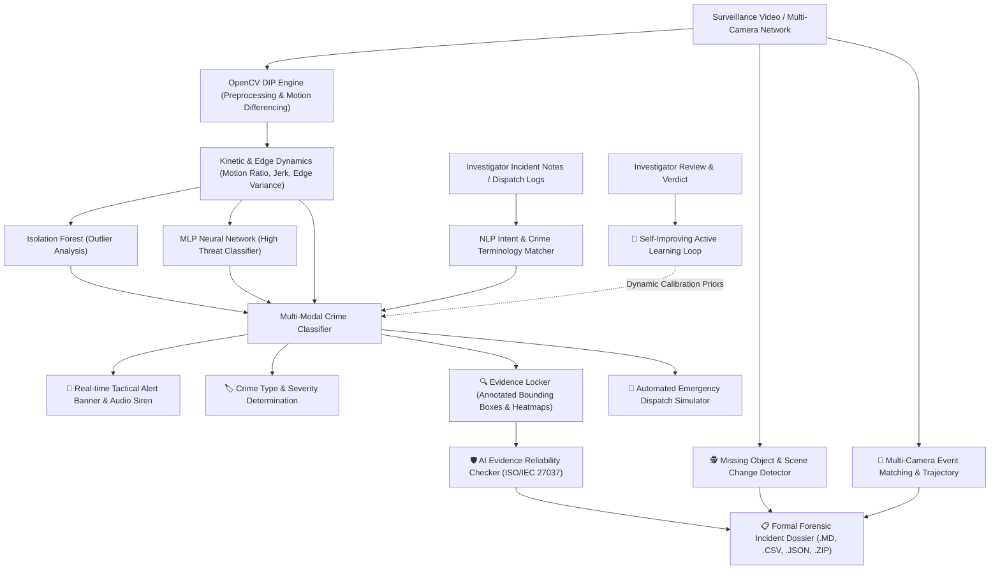

# CrimeVision AI — Advanced Tactical Surveillance & Evidence Suite

CrimeVision AI is an enterprise-grade, AI-assisted surveillance video review, multi-modal crime detection, and forensic evidence extraction platform. It empowers security operators, forensic investigators, and law enforcement personnel to triage video footage, detect crimes in real time, audit evidence reliability under ISO/IEC 27037 standards, identify missing objects / structural scene alterations, correlate suspect trajectories across multi-camera networks, and continuously improve detection models through a self-learning investigator feedback loop.

---

# Crime Vision AI 🚨

> **An AI-powered video analytics system for automated threat detection, real-time surveillance, and intelligence reporting.**

[

## 🚀 Key Forensic Modules & Capabilities



---

### 1. 🛡️ AI Evidence Reliability Checker
- **ISO/IEC 27037 Standards Compliance:** Evaluates extracted keyframes for court admissibility.
- **Laplacian Variance Blur Detection:** Flags motion blur and optical degradation.
- **Illumination & Dynamic Range Auditing:** Evaluates mean brightness, overexposure, and contrast standard deviations.
- **Sensor Noise & Compression Artifact Level:** Detects high-frequency sensor grain and compression compression artifacts.
- **Reliability Scoring & Admissibility Grades:**
  - `GRADE A — HIGH RELIABILITY`: Court-admissible forensic specimen ($82\% - 100\%$).
  - `GRADE B — ACCEPTABLE EVIDENCE`: Substantial evidence ($68\% - 81\%$).
  - `GRADE C — MODERATE / DEGRADED`: Investigative lead only; requires enhancement ($50\% - 67\%$).
  - `GRADE D — POOR / HIGH ARTIFACT RISK`: Inadmissible without corroboration ($< 50\%$).
- **Actionable Forensic Guidance:** Generates automated recommendations (e.g. CLAHE contrast equalization, Wiener deconvolution, secondary angle cross-referencing).

---

### 2. 🎥 Multi-Camera Event Matching (Cross-Camera Correlation)
- **Multi-Feed Spatial-Temporal Correlation:** Correlates suspect movements and incidents across distributed surveillance feeds (e.g., *CAM-01 Perimeter Gate*, *CAM-02 Central Corridor*, *CAM-03 Fire Exit*).
- **Incident Trajectory Reconstruction:** Plots step-by-step suspect movement pathways with timestamps, camera IDs, and actions.
- **Visual Appearance Matching:** Compares 128-dimensional HSV color histogram feature vectors using cosine similarity to verify suspect identity continuity across cameras.
- **Temporal Transit Plausibility:** Validates whether transit times between camera nodes match physical walking and running velocities.
- **1-Click Multi-Camera Network Generator:** Simulates a 3-camera synchronized surveillance network for instant testing.

---

### 3. 🕵️ Missing Object & Scene Change Detector
- **Static Scene Differentiation:** Distinguishes between transient movement (people walking by) and permanent physical alterations.
- **Missing / Stolen Asset Detection:** Detects objects present during baseline monitoring that have disappeared post-incident (laptops, bags, valuables, tools).
- **Structural Damage & Breach Detection:** Identifies shattered windows, forced entry points, displaced furniture, and surface defacement.
- **3-Way Visual Scene Comparison:**
  1. *Baseline Pre-Incident Keyframe* (with green original asset bounding boxes)
  2. *Post-Incident Settled State* (with red/amber missing object or structural damage bounding boxes)
  3. *Permanent Spatial Divergence Map* (Jet/Magma colormap highlighting modified pixels).
- **Itemized Alteration Inventory:** Reports bounding box coordinates, surface area percentage, and damage severity.

---

### 4. 🧠 Self-Improving Investigator Feedback System (HITL)
- **Human-in-the-Loop Active Learning:** Empowers investigators to confirm or correct CrimeVision AI predictions.
- **Audit Logging:** Saves verified cases, true labels, investigator remarks, and confidence ratings to [`investigator_feedback.json`](file:///c:/Users/DELL/Downloads/CrimeVision_AI_Project/investigator_feedback.json).
- **Dynamic Priors & Weight Calibration:** Automatically computes category biases based on historical feedback:
  - Categories with frequent false alarms automatically receive higher kinetic thresholds.
  - Categories with confirmed high precision are prioritized.
- **Performance Analytics Dashboard:** Tracks verified historical accuracy, false alarm rates, and real-time model calibration adjustments.

---

### 5. 🚨 Real-Time Crime Alerts & Multi-Modal Classification
- **Prominent Alert Banner:** Displays color-coded alert level (`CRITICAL` Red, `HIGH` Amber, `MEDIUM` Yellow, `NORMAL` Green).
- **In-Browser Audio Siren:** Integrated Web Audio API chime and siren alerts (with toggle).
- **Multi-Modal Crime Taxonomy:**
  - *Physical Assault / Violent Encounter*
  - *Armed Robbery / Weapon Threat*
  - *Burglary / Perimeter Intrusion*
  - *Theft / Larceny / Quick Grab*
  - *Vandalism / Property Destruction*
  - *Suspicious Loitering / Reconnaissance*
  - *Nominal Baseline Surveillance*

---

### 6. 📦 Complete Digital Evidence Locker & Export Suite
- **OpenCV Annotated Bounding Boxes & Heatmaps:** Keyframe snapshots isolating anomalous zones.
- **Cryptographic SHA-256 Checksums:** Fingerprints master video and every individual evidence frame for chain of custody.
- **1-Click Forensic ZIP Archive:** Bundles high-res annotated frames, heatmaps, `evidence_manifest.json`, and `CHAIN_OF_CUSTODY.txt`.
- **Export Formats:** Markdown report (`.md`), structured JSON dossier (`.json`), frame metrics (`.csv`), and full evidence package (`.zip`).
- **Emergency Dispatch Simulator:** Instant simulated CAD broadcast to Police 911, Security Operations Centers (SOC), and on-site supervisor pagers.

---

## 📦 Installation & Setup

1. **Activate the Environment:**
   ```powershell
   .\.venv\Scripts\Activate.ps1
   ```

2. **Run CrimeVision AI:**
   ```bash
   streamlit run app.py
   ```

3. Open the browser URL printed in the terminal (default: `http://localhost:8501`).

---

## 🧪 Quick Testing Guide

1. **Test Single Camera & Reliability:**
   - Select **"Generate Test Surveillance Scenario"** -> Choose *Physical Assault* or *Burglary*.
   - Click **"🚀 Run CrimeVision AI Analysis"**.
   - Check the **"🚨 Incident Overview"** and **"🔍 Evidence Locker & Reliability"** tabs.
2. **Test Missing Object & Scene Changes:**
   - Select *Theft* or *Burglary* scenario.
   - Open the **"🕵️ Missing Object & Scene Detector"** tab to view before/after bounding boxes.
3. **Test Multi-Camera Matching:**
   - Open the **"🎥 Multi-Camera Matching"** tab.
   - Click **"⚡ Correlate Multi-Camera Network (3 Feeds)"** to view the multi-camera trajectory storyline.
4. **Test Self-Improving Feedback:**
   - Open the **"🧠 Investigator Feedback (HITL)"** tab.
   - Submit a review or correction and observe the dynamic calibration weights update instantly.
   - 
